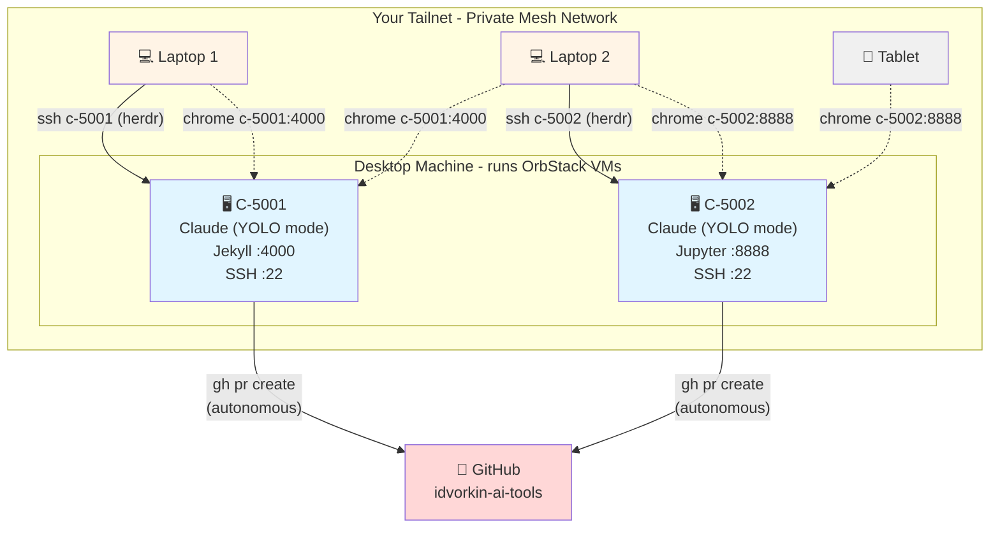

I mumble to Claude on my couch while my family wonders who I'm talking to. I vibe code in the car while my son drives. I rent the most expensive brain I can get. This is my CHOP (Chat-Oriented Programming) setup: the models, the tools, the machines, and what I've learned. The ideas behind it are in [The CHOP Shop](/chop); how it got this way is in [The CHOP Shop, 2024 to 2026](/chop-history).





<!-- prettier-ignore-start -->
<!-- vim-markdown-toc-start -->

- [The Brain I Rent](#the-brain-i-rent)
  - [The Most Expensive I Can Get](#the-most-expensive-i-can-get)
  - [Why Not Codex, Gemini, etc.?](#why-not-codex-gemini-etc)
  - [The Tiers I Delegate To](#the-tiers-i-delegate-to)
  - [When I Need Speed](#when-i-need-speed)
  - [When Models Get Smarter](#when-models-get-smarter)
- [Tools of the Trade](#tools-of-the-trade)
  - [The Past: Cursor](#the-past-cursor)
  - [The Present: Claude Code](#the-present-claude-code)
  - [The Upgrade: Herdr](#the-upgrade-herdr)
  - [Codex, Muse and Grok Through Herdr](#codex-muse-and-grok-through-herdr)
  - [The Dashboard That Arrived](#the-dashboard-that-arrived)
  - [The 8 Stages of AI Coding](#the-8-stages-of-ai-coding)
- [Voice: How I Talk to the Agents](#voice-how-i-talk-to-the-agents)
- [Notes from the Trenches](#notes-from-the-trenches)
  - [What Works Well - REVIEW THIS WEEKLY!](#what-works-well---review-this-weekly)
  - [What I'm Still Figuring Out](#what-im-still-figuring-out)
- [The Control Panel - For This Human](#the-control-panel---for-this-human)
- [Where I Code](#where-i-code)
  - [The Couch](#the-couch)
  - [The Coffee Shop](#the-coffee-shop)
  - [The Desktop Setup](#the-desktop-setup)
  - [The Walking Treadmill](#the-walking-treadmill)
  - [The Car](#the-car)
  - [Ergonomics](#ergonomics)
- [Making AI Work My Way](#making-ai-work-my-way)
  - [The chop-conventions Repo](#the-chop-conventions-repo)
  - [CLAUDE.md Structure](#claudemd-structure)
  - [Beads for Every Task](#beads-for-every-task)
  - [MCP Servers and Skills](#mcp-servers-and-skills)
- [My Projects](#my-projects)
  - [Command Line, PWAs, and Now Apps](#command-line-pwas-and-now-apps)
  - [Testing and Evals](#testing-and-evals)
- [The Server Behind the Curtain](#the-server-behind-the-curtain)
  - [Why Not Cloud Environments?](#why-not-cloud-environments)
  - [Hardware Setup](#hardware-setup)
  - [VM Setup: Cattle, Not Pets](#vm-setup-cattle-not-pets)
  - [Network Setup](#network-setup)
- [A Typical CHOP Session](#a-typical-chop-session)
- [Appendix: Origin of a Tool Nerd](#appendix-origin-of-a-tool-nerd)
  - [The Enabling Environment](#the-enabling-environment)
  - [My Relationship with Tools](#my-relationship-with-tools)
  - [Is This a Waste?](#is-this-a-waste)
- [Appendix: Who I Follow](#appendix-who-i-follow)
  - [Simon Willison](#simon-willison)
  - [Steve Yegge](#steve-yegge)
  - [Kun Chen](#kun-chen)
  - [Twitter](#twitter)
- [Appendix: The Long View](#appendix-the-long-view)
  - [What Management Taught Me About AI](#what-management-taught-me-about-ai)
  - [The Evolution of Junior Developers](#the-evolution-of-junior-developers)
  - [Revenge of the SDET](#revenge-of-the-sdet)
  - [Hyper-Personalized Software](#hyper-personalized-software)
  - [The Joy Question](#the-joy-question)
  - [The Flow Question](#the-flow-question)
  - [What I'm Betting On](#what-im-betting-on)
- [Appendix: Open Questions](#appendix-open-questions)
  - [What happens when execution is no longer the bottleneck?](#what-happens-when-execution-is-no-longer-the-bottleneck)
  - [What happens post-singularity?](#what-happens-post-singularity)
  - [Is sloppy process okay if agents can clean up the mess?](#is-sloppy-process-okay-if-agents-can-clean-up-the-mess)

<!-- vim-markdown-toc-end -->
<!-- prettier-ignore-end -->



## The Brain I Rent

**The core problem:** Different models have different intelligence, and you get what you pay for. You can get a middle schooler or you can get a university student.

### The Most Expensive I Can Get

The main seat is Claude Code with the best Claude model I can get: Opus 5.5, which [brought the joy back](/interaction-model) after a stint with Opus 5 that answered like a ticket system, and Fable 5.1 when the problem is the complicated kind.

One plan isn't enough anymore. The expensive model has its own weekly limit inside the plan, and it runs out first, so I pay for Claude, Codex, and Grok, plus API keys for everything else. On one hand you might think I'm crazy spending that much. On the other hand, imagine having brilliant collaborators who force multiply everything you do, train you up, and basically give you a PhD in whatever you're working on. Which subscription pays for which job is its own post: [How I Manage AI Tokens](/token-management).

### Why Not Codex, Gemini, etc.?

The frontier tools leapfrog each other every few weeks, and switching every time is all cost. Claude Code is home, and I assume it catches up quickly if it ever falls behind. (The month that taught me this, three "oh my god, I've got to try this" releases in a week, is in [the history](/chop-history#2025-h2-claude-code-becomes-the-present).)

The others didn't go away, they became sub-agents. Codex and Muse run [through Herdr](#codex-muse-and-grok-through-herdr) on work I can specify tightly; Grok gets anything about X or current events. The review gate on this blog tries Grok first, then Codex, then Claude, because the Claude quota is usually the tight one. The image gap I complained about closed too: a `gen-image` skill draws through OpenRouter, with Meta's Muse Image as the default.

### The Tiers I Delegate To

When the main session hands work to a background agent, the model is picked by the shape of the task: the strongest model (Fable) for the complicated or ambiguous, Opus for a well-specified build, Sonnet for the mechanical, and never the smallest tier. A build by one model gets a review pass by a different one before it lands. Every background agent gets its own git worktree; two agents sharing a checkout collide.

### When I Need Speed

Sometimes I need really low latency: an interactive loop where a two-second think is too slow. The fast open models serve at a few hundred tokens a second, and I measured what that speed costs in [Fast Tokens, Wrong Answers](/ai-speed-vs-thinking): on one graded puzzle, turning the thinking dial up did not predict a correct answer. For latency-bound work I reach for a fast model and keep the task small.

<!-- TODO(Igor): the page used to say the fast path was Groq. I could not confirm Groq is still in use from the repos (only a Cerebras key and the fast-models post). Name the current provider or leave it generic. -->

(A terminology nit: "Claude" and "ChatGPT" are products, not models. The actual models are Opus, Haiku, GPT, Llama, with version numbers. Everyone, including me, uses these terms loosely.)

### When Models Get Smarter

Looking at [how fast things are moving](https://idvorkin-how-long-since-ai.surge.sh/?show=tool), a natural question: what happens when models get smarter? For this, read [Situational Awareness](https://situational-awareness.ai/) - it introduces the concept of "OOMs" or orders of magnitude in capability.

Given history, I imagine there will be more OOMs. But honestly, even if there aren't, we're at the point of electricity being invented. Thomas Edison invented it, and then how long did it take to find all the applications? A really long time. We're still early.

## Tools of the Trade

**The core problem:** The tools keep changing. What was state-of-the-art six months ago is now deprecated. How do you invest wisely when the ground keeps shifting?

### The Past: Cursor

It's crazy [how fast AI evolves](https://idvorkin-how-long-since-ai.surge.sh/?show=tool). Everything I used before Claude Code (Cursor, Aider, Avante, the chat logs committed next to the code) is in [The CHOP Shop, 2024 to 2026](/chop-history).

### The Present: Claude Code

Claude Code is really about autonomous agents that run in your terminal. As a terminal guy, I can speak to why this is so awesome - it fits my workflow perfectly. The agent runs commands, edits files, and iterates without me micromanaging every step. Every convention I keep is written for it.

### The Upgrade: Herdr

[Herdr](https://herdr.dev) is a multiplexer that knows what an agent is. Same terminal, same SSH, same detach-and-reattach as tmux - but every workspace shows blocked / working / done / idle, spinning up a git worktree is one command, and there's a socket API the agents themselves can drive. It replaced a year of tmux duct tape; that story is in [my journal](/ai-journal#herdr-the-agent-multiplexer-my-tmux-rig-was-trying-to-become).

Here's my actual herd. Spaces tree top-left, agent states below it (spinners are working, checks are done), a live Claude session in the main pane. And a bonus: the `herdr` agent in that list is the Claude session that took this screenshot.

### Codex, Muse and Grok Through Herdr

Because Herdr has a socket API, my main Claude session can open a tab, start a Codex or [Muse](/claw#muse-a-claw-a-grandma-can-use) agent in it, hand over a brief, and wait for the result, which makes the other vendors' agents sub-agents of mine instead of competitors for my attention. The brief is a bead in the target repo, the worktree comes from a pool, and the commit is attributed to the agent that wrote it. The recipe is the [muse-herdr](https://github.com/idvorkin/chop-conventions/tree/main/skills/muse-herdr) skill; the [herdr](https://github.com/idvorkin/chop-conventions/tree/main/skills/herdr) skill drives the multiplexer itself.

### The Dashboard That Arrived

The multi-agent dashboard I once filed under "the future" ([history](/chop-history#january-to-april-2026-mumbling-on-the-couch)) arrived in three pieces: [the AI Cockpit](/ai-cockpit), my control surface for watching slow parallel agents; [the Cockpit Larry built for me](/larry-cockpit), where a non-coding agent takes my decisions out of a chat scroll; and [Gas City](/gas-city), where the orchestration lives in the city rather than in my head. I didn't build the first dashboard at all. I gave the requirements and Claude built it.

### The 8 Stages of AI Coding



This diagram perfectly captures the evolution I've lived through. Let me break down what each stage actually means:

**Stages 1-4: The Solo Developer Journey**

1. **Manual Coding** - Just you and your editor. Every line typed by hand. The good old days (which weren't always that good).

1. **Approval-Based Agent (Y/N?)** - AI suggests changes, but stops to ask permission for each action. Tab completion evolved into "should I run this test?"

1. **YOLO Mode** - The turning point. AI can execute commands, make commits, run tests without asking each time. This is what [disposable VMs](#vm-setup-cattle-not-pets) enable safely.

1. **Full Autonomy** - AI doesn't just execute commands - it plans multi-step workflows and handles the entire development cycle. This is where Claude Code shines today.

**Stages 5-8: The Multi-Agent Era**

1. **Single Agent** - One Claude Code session per project. Good for focused work, but limited by serial execution. This is where most people are today.

1. **Parallel Agents** - Multiple Claude Code instances working on different features simultaneously. You become a coordinator, switching between agents. This is when you discover the pain of merge conflicts and context switching.

1. **Specialized Tools** - Different agents have different capabilities. One handles tests, another docs, another deployment. You're orchestrating specialists, not generalists. The [optimal number of agents](#what-im-still-figuring-out) becomes critical.

1. **Orchestrated System** - This is the vision: a central dashboard managing dozens of specialized agents. You're no longer coordinating individual agents - you're managing the system that coordinates them. I drew the bricks that system is made of in [AI Orchestrators](/ai-orchestrator).

**Where I Am Today:** Stage 7 for the daily work, with a foot on stage 8. The herd screenshot above is nine workspaces with four agents mid-flight, supervisable because of [Herdr](#the-upgrade-herdr) and [the cockpit](/ai-cockpit). For work that's plural and carries judgment, [Gas City](/gas-city) runs the coordination; [the ladder I climbed to get there](/gas-city#the-ladder-i-climbed-to-get-here) is the same four rungs as the one in [The CHOP Shop](/chop#the-herd-one-agent-to-a-city). Merge hell is mostly gone (a worktree per agent did it); when to use a specialist versus a generalist is still a judgment call I get wrong.

## Voice: How I Talk to the Agents

Most of my prompts are spoken. I talk to the agents the way I'd talk to an engineer at a whiteboard: half-formed thoughts, "actually wait, try this instead," trailing off mid-sentence. Transcription quality barely matters, because the receiver is smart enough to respond to my intent instead of my mangled words. Voice is also why the couch, the treadmill, and the car are all places I code.

At home it's [Wispr Flow](https://wisprflow.ai/) and a lapel mic, which turned out to matter more than the software. The write-up, including the mic and the ring I use as a remote for it, lives in the cockpit post: [Voice Input - The Primary Interface](/ai-cockpit#voice-input---the-primary-interface). Why voice changes how you think, not just how you type, is in [You Need to Use Voice](/ai-operator#you-need-to-use-voice).

## Notes from the Trenches

### What Works Well - REVIEW THIS WEEKLY!

**Note to self: Review this section regularly. These principles are easy to forget when you're heads-down in a session.**

- **Rent the most expensive brain you can**: Spend tokens liberally. The subscriptions are nothing compared to the force multiplication you get; just [know which window is about to reset](/token-management)
- **Maximize time between interventions**: Like Tesla's self-driving metrics, the goal is reducing how often you need to take over. Every friction point kills flow
  - **Don't be the intern doing grudge work**: If AI writes code and you manually test it, you've got the roles backwards. Make AI the tester too - be the architect, not the QA intern
  - **Tests as specification**: The clearer the tests, the less I need to intervene
  - **Always be able to rewind**: Disposable VMs and git workflows mean you can experiment fearlessly. If something breaks, spin up a fresh machine in seconds
  - **Conventions compound**: Time spent on CLAUDE.md pays off across every session
- **Isolation is freedom**: YOLO mode on a throwaway VM lets Claude run autonomously without risk to my real environment
- **A worktree per agent, a bead per task**: the two rules that ended merge hell and lost work
- **"Don't glaze me" changes everything**: Claude is far more useful when it pushes back on bad ideas
- **Rot repair is nearly free**: Reviving a stale project used to mean a weekend of toolchain archaeology ([Software Rot](/d/2017-09-10-software-rot)); now an agent grinds through the upgrades for me

### What I'm Still Figuring Out

(The first draft's questions, merges, DRY vs. self-contained, tests first vs. after, have answers now; they're [in the history](/chop-history#january-to-april-2026-mumbling-on-the-couch) with what answered them.)

- **Quota is the real constraint.** When I'm typing I'm the rate limiter; when agents run unattended nobody is. Routing work across subscriptions by headroom is a new chore.
- **Review cost.** Agents produce faster than I can read. Lavish boards and a second-model review pass help; I still don't have a clean answer for what I can safely skip.
- **Agents stealing channels.** Two sessions that can both answer my Telegram will both try. The fix so far is process discipline (one session owns the bridge), which is exactly the kind of rule I'd rather the tooling enforced.
- **The optimal number of agents**, still. Fewer than I can run, more than one, and the right number changes with the quality of the spec.

## The Control Panel - For This Human

**The core problem**: agents are slow, not fast. The mitigation? Run several in parallel. But humans aren't designed for parallel orchestration. You need a cockpit — voice input, physical buttons, a dashboard, and instant session switching — to keep track of it all without losing your mind.

I wrote up the full cockpit setup separately:



## Where I Code

**Not a problem - an opportunity.** When things change, previous constraints change too. Voice coding + cloud containers = newfound freedom. I'm no longer tethered to a desk with a keyboard. I'm still figuring out how to use this freedom.

### The Couch

I really like coding on the couch because I feel like I'm with my family even though I'm there mumbling. There's a bit of a lie here - I kind of don't see my family and they're very confused about who I'm talking to.

Humorous side note: after a coding binge where I did 60 hours of vibing two weeks in a row, when I stopped my family asked "Are you okay? You're not just mumbling to yourself anymore."

### The Coffee Shop

Unfortunately I can't use voice here, but I really enjoy being at a coffee shop - seeing the people, the ambient noise, all that jazz. There's something about the energy of a public space that keeps me focused.

### The Desktop Setup

Using a big monitor is awesome - all that real estate. I've also experimented with using multiple monitors to help me keep track of different things: agents running in one screen, code in another, docs in a third.

### The Walking Treadmill

Just today, as I was writing this post, I realized: "Hey, I could do this walking since I'm using voice." So parts of this post were spoken while walking on my under-desk treadmill. Kind of cool.

### The Car

Yes, I can vibe code in the car too. My 16-year-old son is learning to drive and drove us back from a 10-hour drive from Ashland, Oregon. I spent the entire time vibecoding. That probably contributed to my [shoulder impingement](/shoulder-pain).

### Ergonomics



**The danger of all this freedom.** Be careful about ergonomics, especially if you're an [older coder](/40yo). Coding on couches, in cars, and in awkward positions adds up. Your body will eventually present the bill.

## Making AI Work My Way



**For nerds:** This whole strategy fights against the [Bitter Lesson](http://www.incompleteideas.net/IncIdeas/BitterLesson.html). Rich Sutton argued that simple methods + more compute beats hand-crafted human knowledge. Building elaborate CLAUDE.md files and conventions is exactly that - encoding human knowledge instead of letting models get smarter. The irony isn't lost on me.

**The core problem:** Every session, the AI starts fresh. It doesn't remember your preferences, your project structure, or what you've already discussed. Conventions are how you encode context that persists.

### The chop-conventions Repo

I maintain a shared conventions repo at [idvorkin/chop-conventions](https://github.com/idvorkin/chop-conventions). It's wired in rather than read:

- **Skills** live in the repo and are symlinked into `~/.claude/skills/`, so an edit goes through a PR once and every machine picks it up.
- **Fragments** of the global instructions are assembled per machine class (every machine, dev VMs, the Mac) by an `up-to-date` skill that also installs the standard plugin list.
- **Conventions** for the inner loop (clean commits, PR workflow, guardrails, repo modes) are what a new repo's `AGENTS.md` points at instead of restating.

Change once, propagate everywhere, version controlled. The first thing an agent does in any of my repos is read that repo's `AGENTS.md`, which tells it where the rest is.

### CLAUDE.md Structure

Every repo has one `AGENTS.md`; `CLAUDE.md` is a symlink to it, so every agent reads the same file. The pattern inside: foundational rules (honesty, call out bad ideas), guardrails (no pushing to main, no removing tests), relationship framing (we're colleagues, push back when I'm wrong), and project-specific guidance. The global file is the same idea in layers: rules I want everywhere, rules for this class of machine, rules for this one box.

The theory: tell Claude _how to think_, not just _what to do_. "Don't glaze me." Before writing code, climb the laziness ladder: does it need to exist, is it already in the codebase, is it in the standard library, is it one line? Whether that actually shapes behavior across sessions? I genuinely don't know. What I do know is that the file writes itself now: a `learn-from-session` pass at the end of a long session extracts the lessons and routes each to the file it belongs in.

Here's the thing: every time models get smarter and tools get better, my CLAUDE.md becomes partially obsolete. Especially the alchemy - yelling at the model, begging it not to do a bad job, elaborate prompting tricks. That stuff has a short half-life. But some things stay useful: custom commands to run, project-specific context, where to find things. The challenge is knowing which is which.

One datapoint on the side of less: an [RL project teaching a model to draw with a niche JavaScript library](https://surya.website/rling-qwen-to-paint-with-code) started with a 400-line API reference in the system prompt, and the model wrote confident, well-formatted code calling functions that didn't exist. Throwing the reference out and replacing it with an allowlist of eight approved methods - no docs, no examples - is what made it start working. Short and opinionated beat complete.

### Beads for Every Task

Every task gets a bead before any code moves, even quick background work. [Beads](https://github.com/steveyegge/beads) is Steve Yegge's issue tracker for agents: a CLI (`bd create`, `bd ready`, `bd close`), a dependency graph, and a database that survives a process dying. Two things it buys me. The bead is the brief: a background agent reads it instead of a prompt I'd have to retype, and it comments its progress there. And the bead is the handoff: a session that compacts or crashes picks up from the notes on the bead, not from a chat scroll that's gone. It's also the unit of work in [Gas City](/gas-city#what-a-city-is), so the same `bd` commands drive my cities and my one-off agents.

### MCP Servers and Skills

MCP servers: a docs fetcher so the agent reads current library docs instead of guessing, and not much else. Skills are a different story: a couple dozen in the conventions repo, a shared plugin list every machine installs, and the kit I reach for daily is in [The Skills I Use](/ai-operator#the-skills-i-use). (I once said "two or three max" about all of this; [the history](/chop-history#january-to-april-2026-mumbling-on-the-couch) keeps the receipt.)

**What does matter:** Little CLI programs for my agents to run. Same principle as with humans - instead of giving someone detailed directions, give them a tool that just works perfectly to solve the problem.

For example, I have [`running-servers`](https://github.com/idvorkin/settings/blob/main/shared/running-servers) that checks if a Jekyll server is already running for a directory, so agents don't try to recreate them. Instead of prompting the agent through "check ps, grep for jekyll, parse the port numbers, compare to current directory..." - just give them a tool that answers "is there a server for this directory?" Most skills are a thin wrapper on a CLI like that. These custom tools that extend what agents can do - those are worth building.

Same principle for giving agents the web: [Browsers for Machines](/browsers-for-machines) covers the Lightpanda and Playwright CLI setup behind my `/web-browse` command - JS-rendered pages and screenshots without flooding the context window.

## My Projects

### Command Line, PWAs, and Now Apps

Most of my tools are either command line or PWAs. Command line - obviously, when I'm on the command line, which is often. For everything else, PWAs: local-first, run everywhere, no app store hassle. They're remarkably flexible.

CHOP widened what I'll attempt. iOS apps I'd never have built by hand ([a lift tracker that counts reps from the camera](https://github.com/idvorkin/exercise-analyzer), [a health and location exporter](https://github.com/idvorkin/context-grabber)). [Explainer sites](/explainers), one per course or lecture, [indexed in one place](https://idvorkin-ai-tools.github.io/). [Named agents](/igors-claws) with their own jobs, including [Larry](/larry), who built [his own dashboard](/larry-cockpit). And [The Den](/the-den), a comic strip about running all of them, with the real transcript under each gag.



CHOP has made it so much easier to spin up new ideas and actually finish them.

### Testing and Evals

This might be the most important thing. In the CHOP world, knowing how to verify that AI output is correct matters more than knowing how to produce it. It's all about evals - can you define what "good" looks like and measure whether you're there?

Once the eval is sharp, the search loop runs itself: [eval-driven hill climbing](/hill-climbing) — the agent proposes variants, the eval scores them, the winner becomes the next baseline. You write the fitness function; the agent does the climbing. How I test the models themselves is in [Testing AI](/ai-testing), the tools are compared in [AI Eval Tools](/ai-eval-tools), and the gate that runs the checks on every PR is in [A Typical CHOP Session](#a-typical-chop-session).

## The Server Behind the Curtain

The metric that matters most in CHOP is **time between interventions**. Like Tesla's self-driving, the goal is reducing how often you need to take over. Every friction point - waiting for a slow laptop, losing context when you switch machines, being scared to let the AI run autonomously - increases interventions and kills your flow.

My hosting environment is designed to minimize these interruptions.

### Why Not Cloud Environments?

Why not just use Claude Cloud, Jules, Codespaces, or other hosted environments? They're limited in their setup - you can't customize the tooling, install arbitrary dependencies, or configure things exactly how you want. And honestly, it's easy enough to set up your own. The initial investment pays off quickly when you're not fighting constraints.

### Hardware Setup

**Why it matters**: I can start a CHOP session at home, close my laptop, commute, and pick up from a different device. The work lives on the VM, not on any particular machine. Zero intervention required for location changes.

A desktop machine runs several Ubuntu VMs under [OrbStack](https://orbstack.dev/). I [mosh](https://github.com/mobile-shell/mosh) in from laptops, tablets, wherever. (Mosh is self-reconnecting SSH - survives laptop sleep, network switches, everything.)

### VM Setup: Cattle, Not Pets



**Why it matters**: Agents will wipe your machine. Give them YOLO mode (run every command without asking) on your laptop and eventually one will `rm -rf` something important or force-push to main with your real credentials. Isolation gives you a blast radius: if Claude breaks something, it's one disposable VM, not your life's work.

The machines started as Docker containers ([the original setup](https://github.com/idvorkin/Settings/blob/master/claude-docker/README.md)) and are OrbStack Ubuntu VMs now; the principles didn't change:

- **Cattle, not pets.** Nothing precious lives on the VM. Spin one up, let the agent work, throw it away. The names (`c-5001`, `c-5002`) started as Jekyll port numbers and stuck as hostnames.
- **Credential separation.** The agent has its own GitHub identity, [`idvorkin-ai-tools`](https://github.com/idvorkin-ai-tools), with its own token. It can open PRs against my repos; it cannot push to `main` in my name. See [Guardrails and Gates](/chop#guardrails-and-gates).
- **YOLO inside the walls.** Claude runs with permission prompts off. Bypass mode still refuses a few things by design (writes outside the working directories, secrets files, shell metacharacters in paths), and the [yolo](https://github.com/idvorkin/chop-conventions/tree/main/skills/yolo) skill documents what it does and doesn't skip, because "why is it still prompting me" is the most common question.
- **CPU guard**: an OrbStack VM core cap plus a [small userspace watchdog](https://github.com/idvorkin/Settings/blob/main/shared/cpu-watchdog.sh) that attaches `cpulimit` to any runaway process — one feral agent can't starve the other five when half a dozen are running in parallel.
- **Several VMs, several sessions.** Parallel CHOP on different repos, and a fresh VM in seconds when one breaks itself.

### Network Setup

**Why it matters**: No port forwarding, no VPN configuration, no "works on my machine." I can share a preview link with anyone on my tailnet, or pull up my work on my phone to check something. Location-independent access to everything.

Every VM joins my Tailscale mesh network and gets a stable hostname:

- VM `c-5001` becomes `c-5001.squeaker-teeth.ts.net`
- Servers bind to `0.0.0.0` so they're network-accessible
- Same URLs work from home, coffee shop, or traveling
- A branch preview gets served tailnet-only on its own port, so every PR link I get comes with a preview link I can open on my phone

## A Typical CHOP Session

The loop is the same every time; [The CHOP Shop](/chop#the-loop) has the why, this is the what.

1. **Ask.** I say what I want, usually by [voice](#voice-how-i-talk-to-the-agents), to the main Claude session running in Herdr on a VM.
2. **Bead.** The session files a bead with the ask in the description and the approach and traps in the design notes. If the work belongs to another repo, the bead goes there, and the agent that picks it up reads that repo's `AGENTS.md` first.
3. **Worktree.** A background agent gets its own worktree. For the blog the worktrees come from a pool of pre-warmed ones ([Treehouse](https://github.com/kunchenguid/treehouse)), because a fresh checkout here needs gems, `node_modules`, and a site build before the first commit can pass the hooks.
4. **Agent.** An Opus or Fable sub-agent for most things; Codex or Muse through Herdr when I want a different vendor on it; Grok when it's about X.
5. **Gates.** Pre-commit hooks (`prek`) catch the cheap mistakes. A `pr-checks` skill prints the PR review checklist, with the structural checks as code and the prose checks judged by a model. The [no-mistakes](https://github.com/kunchenguid/no-mistakes) gate runs lint, the site build, the fast tests, and that checklist before the PR opens.
6. **PR plus preview.** The PR goes to my repo from the agent's fork. A Jekyll serve of the branch runs on the VM, served tailnet-only, and the dev banner at the top shows the PR number and a diff of the page against main, so I review on my phone.
7. **Review.** For anything bigger than a paragraph the agent builds a [Lavish](https://github.com/kunchenguid/lavish-axi) board: an HTML page I can annotate, and the annotations go back to the agent as the next prompt. A build by one model gets a review pass by a different one.
8. **Merge.** Mine, on my repos. On the agent org the agent merges and I triage after.
9. **Close-out.** `pr-hygiene` checks every open PR for unanswered review feedback before the session ends; `learn-from-session` writes the durable lessons back into the conventions; the weekly [changelog](/changelog) picks up the rest.

{% include alert.html content="**My stack, October 2026.** Claude Code (Opus 5.5 in the main seat, Fable 5.1 for the hard problems) · Herdr 0.9 as the multiplexer · Treehouse 3 for pooled worktrees · beads 1.3 for tasks · Codex, Muse and Grok as sub-agents · prek hooks, pr-checks and no-mistakes as gates · Lavish boards for review · quota-axi for the meters · Wispr Flow and a Lark lav mic for voice · OrbStack Ubuntu VMs on a desktop, behind Tailscale. When this rots, replace the box, not the prose." style="info" %}

## Appendix: Origin of a Tool Nerd

### The Enabling Environment



This philosophy is _why_ I invest in CHOP infrastructure. Every minute spent on VM setup, conventions, and tooling is friction removed from future work. The enabling environment isn't about productivity for its own sake - it's about creating the conditions where good work can happen naturally.

CHOP is the latest chapter in this story: building systems that let me focus on the interesting problems while automating the tedious ones.

### My Relationship with Tools

I've always been a tool nerd. VIM since forever. Command line over GUI. Custom scripts for everything. The joy isn't just efficiency - it's the craft of building your own workshop.

CHOP fits this pattern: I'm not just using AI, I'm building an AI-augmented development environment. The VMs, the conventions, the workflows - they're all tools I'm crafting for a new kind of work.

### Is This a Waste?

Every month your setup is stale. New models drop. New tools appear. Best practices from six months ago are now anti-patterns. Is it even worth trying to keep up?

I spent years mastering VIM. Was that a waste? I built elaborate tmux workflows. Will that matter in two years? (Partly answered: [Herdr replaced them](#the-upgrade-herdr) within the year.) I'm investing in VM infrastructure and conventions. Is this the buggy whip factory of 2025?

My answer: **it depends on what you're actually learning.**

- Learning specific keystrokes? Maybe a waste.
- Learning to reduce friction and build enabling environments? Transferable forever.
- Learning a specific tool's quirks? Probably temporary.
- Learning how to delegate effectively to agents? That's the new core skill.

The meta-skill is knowing which investments compound and which depreciate. Right now, I'm betting that _orchestration_ skills (conventions, delegation, verification) will outlast _implementation_ skills (specific languages, specific tools).

## Appendix: Who I Follow

### Simon Willison

I read [Simon Willison](https://simonwillison.net/) religiously. So much content, constantly experimenting, always sharing what he learns. If you're only going to follow one person on AI-assisted development, make it him.

### Steve Yegge

[Steve Yegge](https://steve-yegge.medium.com/) is my hero. Super fun to read, deeply experienced, and unafraid to have strong opinions. His takes on where AI coding is headed are worth paying attention to.

### Kun Chen

Half the gates and meters in my loop are [Kun Chen's](https://github.com/kunchenguid) tools: [no-mistakes](https://github.com/kunchenguid/no-mistakes) for the review gate, [quota-axi](https://github.com/kunchenguid/quota-axi) for the quota windows, [lavish-axi](https://github.com/kunchenguid/lavish-axi) for the review boards. He builds for the problem I have this week, which is the best kind of person to follow.

### Twitter

Huge mixed bag. Sometimes there's something genuinely good. Usually it's people selling stuff. I keep a list but approach with skepticism.

## Appendix: The Long View

### What Management Taught Me About AI

Good delegation to humans requires clear expectations, appropriate context, and defined success criteria. Same with AI.

When delegation fails, it's usually because:

- The task wasn't well-specified (AI hallucinates requirements)
- Success criteria were unclear (AI optimizes for the wrong thing)
- I didn't give enough context (AI makes reasonable but wrong assumptions)

The conventions repo and CLAUDE.md are essentially delegation infrastructure - encoding all the context an AI needs to work autonomously.

### The Evolution of Junior Developers

You don't need to know the "how" nearly as much anymore. The key skill becomes spec/verify - which is closer to PM than traditional engineering.

And what do PMs do? Two things: understand the business, and understand people - helping people feel good about what's happening. Those skills don't go away. If anything, they become more important when the "how" is increasingly handled by AI.

We have junior PMs. Maybe that's the new on-ramp.

### Revenge of the SDET

Back when I started in programming, we had SDETs - Software Development Engineers in Test. They were software engineers who focused more on testing than writing the actual code. These folks were kind of looked down upon, and the role eventually disappeared at most companies.

But now in the CHOP world? Testing is actually the most important thing. It's all about the evals. The person who can specify what "correct" looks like, write the tests that verify it, and evaluate whether the AI's output meets the bar - that's the bottleneck skill now.

The SDETs were ahead of their time.

### Hyper-Personalized Software

With coding so easy, might as well make a tool just for your use case. No need to find an app that's 80% right - build exactly what you want in an afternoon.

I think there's a pendulum here:

- 90s: Every company needed their own IT department
- 2000s: SaaS - rent the same software as everyone else
- 2030s: Single dev does all the required tooling, personalized to their exact needs

My most optimistic view: the cost of software goes down, so an engineer like me can be more ambitious, so demand for software goes up. A company that would never have dreamed of a custom CRM for its industry, because it took twenty engineers a year, is in the market when it takes four engineers three months.

See more in my [hyper-personalization](/hyper-personal) post. Examples from my own life: [handwriting journal workflow](/process-journal#current-workflow), [mortality software](/mortality-software), [explainers](/explainers), [all my pet projects](/pet-projects).

### The Joy Question

Does CHOP kill the joy of coding? See the deeper exploration in [Will CHOP Kill the Joy of Coding?](/chop#will-chop-kill-the-joy-of-coding).

My take: the joy shifts, it doesn't disappear. Less joy in typing code, more joy in:

- Designing systems at a higher level
- Crafting the perfect specification
- Building the enabling environment itself
- Solving problems I couldn't tackle alone

It's like the transition from assembly to high-level languages. Some people mourned losing the craft of register allocation. Most found new joys in the problems they could now solve.

### The Flow Question

Someone asked me: "Can you still get flow when you're chopping? You're not even writing the code." They assumed no — that flow lives in the typing.

I'm in flow constantly. It comes from orchestrating — juggling two or three agents at different points in their loops, nudging one, reviewing another, letting the third cook. That rhythm is its own zone, which is exactly why I built [the cockpit](#the-control-panel---for-this-human). And it comes from mastery — I'm nowhere near done learning how to operate these things (see [/ai-operator](/ai-operator)), and challenge-meeting-skill is where flow has always lived.

That's where the joy of chopping comes from for me. Not mourning the typing — being in the zone while orchestrating a team.

The honest counterpoint: [Sean Goedecke frames](https://www.seangoedecke.com/how-to-keep-thinking/) this exact mode as a frenetic game show — all rapid skimming and judging, crowding out the slow hammock time deep thought needs. My take on that trade is in [vibing](/vibing#all-game-show-no-hammock).

### What I'm Betting On

- **Practice and self-improvement always win**: The tools change, but [learning new skills](/new-skills) is the constant. You're going to suck until you die - that's just how mastery works.
- **Conventions become critical**: As AI gets smarter, the bottleneck shifts to specification quality. CLAUDE.md-style files will matter more, not less.
- **Verification beats implementation**: Knowing _what_ to build and _how to verify_ it matters more than _how_ to build it. The full ordering is in [The Skills That Matter Now](/chop#the-skills-that-matter-now).
- **Multi-agent coordination will improve**: Today's pain of running parallel agents is a tooling problem, not a fundamental limit. (Scored a year on: worktrees, Herdr, and the city took most of the pain; see [the herd](/chop#the-herd-one-agent-to-a-city).)
- **The enabling environment philosophy applies more than ever**: The winners will be those who invest in reducing friction.

## Appendix: Open Questions

### What happens when execution is no longer the bottleneck?

Right now, we're still limited by how fast we can build things. But that's changing fast. What becomes the constraint then?

**How do organizations handle 200x more projects?** Imagine a company like Meta that used to run N projects because engineering capacity was the limit. Now they can run 200N projects. How do they even assess them all? How do they A/B test that many variants? It's going to be a crazy world.

My current answer is two jobs - iterating on the job to be done, and keeping the code changeable by agents - in [What's Left in Engineering?](/whats-left).

**Reviews become more expensive than creation.** LLVM hit this with PRs - they had to create a [whole AI tool policy](https://discourse.llvm.org/t/rfc-llvm-ai-tool-policy-human-in-the-loop/89159) because reviewing AI-generated contributions takes more human time than the AI spent creating them. TL;DR: You're responsible for anything your AI creates. If you can't answer questions about what the AI did, your PR fails. But this applies to everything - not just code.

### What happens post-singularity?

First, what's a singularity? It's when AI can generate the majority of economic value with a very small group of people who have a ton of leverage.

At that point, two problems:

1. **How do people eat?** There are solutions - easier said than done - like UBI.
2. **How do people have purpose?** This one is even harder. I feel it in my bones. But you know what? Humans have always figured it out, and I'm sure they'll do it again.

### Is sloppy process okay if agents can clean up the mess?

[Beads](https://github.com/steveyegge/beads) constantly gets into broken states - leftover file leases, corrupted issue data, stale git references. Traditional software engineering says: prevent these states, make workflows deterministic, fail fast. But here's the thing: agents just... fix it. They see the mess, figure out what went wrong, and recover.

Steve Yegge describes using [MCP Agent Mail](https://github.com/Dicklesworthstone/mcp_agent_mail) for multi-agent coordination: "You just give them a task and tell them to sort it out amongst themselves. There's no ego, so they quickly decide on a leader and split things up... Although it seems crazy to work that way, the agents just figure it out—they're quite resilient." See his [Beads Best Practices](https://steve-yegge.medium.com/beads-best-practices-2db636b9760c) post.

This raises uncomfortable questions: If agents can recover from any workflow mess, do we still need disciplined processes? We've spent decades building guardrails to prevent non-deterministic states because _humans_ can't handle the chaos. But agents can. Maybe the discipline shifts from _how you work_ to _what you produce_. Maybe it's fine if your agents are sloppy, leave garbage lying around, and get into weird states - as long as the output is correct. The craftsmanship moves from the process to the artifact. I don't know what to do with this yet.

The newer datapoint cuts the other way. An autonomous maintainer on the Beads project [shipped a release nobody approved](/ai-journal#an-agent-shipped-a-release-nobody-approved--and-the-postmortem-is-boring), because the real release process lived in private conversations and not in the file she read. Sloppy state was fine; sloppy _process_ was the bug. Maybe the discipline that survives is the kind you can write down for the agent.

(By the way, this is how I use voice. My voice input ends up being garbage - half-formed thoughts, wrong words, trailing off mid-sentence - but agents figure out what I meant and respond to my intent, not my mangled transcription. Even the _input_ can be sloppy now.)
