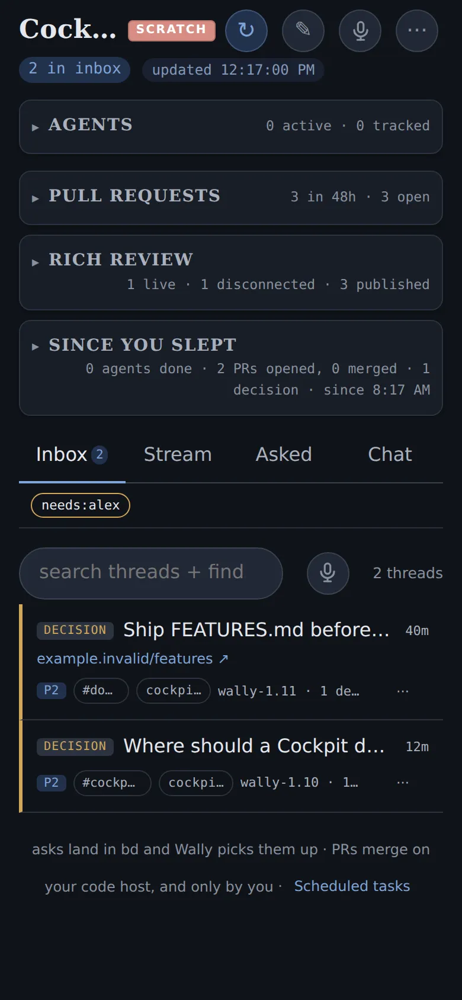
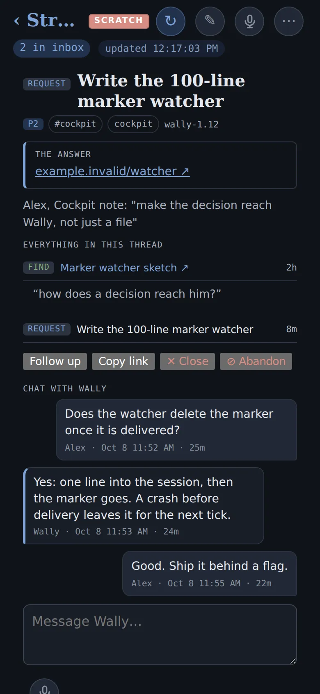

Jeff Bezos has always had a personal chef who knows he hates capers but loves dill. A butler. A tailor with his measurements. A physician who's known his family for years. None of this is new — Vanderbilts had the same staff a century ago. The middle class had pieces of it — your tailor knew your sleeve, your barber knew your part, your family doctor remembered your kids' names — and the poor had almost none: generic clothes, generic schools, generic medicine. The desire was universal; what gated it was cost. Human attention scales 1:1 with each customer — a butler who tracks 47 people equally well doesn't exist — so personalization stayed scarce, concentrated where the money was, thin everywhere else.



**The big shift is the price.** AI dropped the marginal cost of personal attention through the floor. The world Bezos paid for is becoming the everyone-default — same staff, at the cost of a query. And the AI version goes further than Bezos's staff ever could: even his chef didn't know how his blood sugar responded to last week's pasta, his trainer didn't see his HRV trend, his physician couldn't pattern-match across a decade of journal-and-location data. Hyper-personalization isn't just democratizing the old kind. It's reaching into dimensions that didn't exist at any price.

It's also not just words. The same machinery hyper-personalizes images, podcasts, songs, TikToks — your own personalized YouTube channel-of-one. Whatever medium you consume, AI can build a version of it tuned to you alone.

Where does all that newly-cheap personal attention go? **Learning is the headline win.** A student — or any adult trying to pick up a new skill — used to be stuck with the average textbook plus whatever attention they could get from a teacher splitting time across 30 kids. Now: a tutor who knows the specific prior misconception blocking _you_, who already understands what you've grokked, who explains the next concept in vocabulary you ground in. The kid who couldn't get past chapter 4 and the kid who's three chapters ahead get different explanations from the same source, each pitched to where they actually are. That's a step-function improvement in how fast humans can learn anything.

Then **coaching** — a life coach who's read your journal, knows your sleep, sees what you're actually struggling with this season. **Experiences** — a children's book starring your kid, a podcast that walks you through the 7 Habits in your own dialect, a workout titrated to today's HRV. **Entertainment** — jokes in your specific sense of humor, memes that hit because they're tuned to your taste.

And the unlock for creators is enormous. The publisher-reader transaction inverts. Today: one book, every reader, the same words. Tomorrow: one source, infinite tailored explanations, each fidelity-checked against intent. A 14-year-old reads one version, a CEO reads another, a domain expert reads a third — all from the same canonical artifact you wrote once. The author scales without losing signal. Your audience isn't readers anymore; it's people for whom the system rewrites your work, with you as the source of truth and an author-agent guarding the fidelity. Make something true once; it lands a thousand different ways without you having to write it a thousand times.

<!-- prettier-ignore-start -->
<!-- vim-markdown-toc-start -->

- [General](#general)
  - [Why do we like personalization](#why-do-we-like-personalization)
  - [It's everywhere once you start looking](#its-everywhere-once-you-start-looking)
  - [Already happening online — the ML-ranking progression](#already-happening-online--the-ml-ranking-progression)
  - [Hyper-personalization can go into dimensions you weren't thinking.](#hyper-personalization-can-go-into-dimensions-you-werent-thinking)
  - [The Winchester Mystery House: Hyper-Personalization of Software Itself](#the-winchester-mystery-house-hyper-personalization-of-software-itself)
  - [Your AI Second Brain — The Ultimate Personalization](#your-ai-second-brain--the-ultimate-personalization)
  - [Hyper-personalization to your group or tribe](#hyper-personalization-to-your-group-or-tribe)
- [Downside of hyper personalization](#downside-of-hyper-personalization)
  - [We want shared experiences](#we-want-shared-experiences)
  - [Why SaaS still lives](#why-saas-still-lives)
  - [Choice Paralysis](#choice-paralysis)
  - [Open questions](#open-questions)

<!-- vim-markdown-toc-end -->
<!-- prettier-ignore-end -->

## General

### Why do we like personalization

A thing that fits you specifically does its job dramatically better than a thing built for "the average person." A suit cut for your shoulders moves differently than a suit cut for average shoulders. A book that knows your particular confusion lands where a generic textbook bounces off. A trainer who's watched you deadlift for two years writes you a different program than a trainer pulling a beginner template off the shelf. The fit _is_ the function — when it's truly yours, it works; when it's not, you spend energy compensating for the mismatch.

We're built for it. Mom adapted to each kid, the village elder adapted his advice to who he was talking to, the medicine man knew which member of the tribe was prone to which ailment. The default human mode of help is one-to-one and personalized. Mass production was the historical aberration — a side effect of industrial scale that couldn't economically reach into each customer's actual context. Hyper-personalization is the rule reasserting itself once the cost curve allows.

### It's everywhere once you start looking

It's like a fish noticing water. Once you've named the pattern — _desire is constant, cost is the gate_ — you see it spilling out in every direction.

- **Choice count over time.** 1 TV channel → 30 cable channels → 300 → 1000 YouTube channels → a million TikToks. Each step is more personalization per viewer-hour. Ice cream went 3 flavors (Neapolitan) → Baskin-Robbins' 31 → today's gelato bars where you build any combination → at-home machines that mix to your preference profile.
- **Continuous, not discrete.** It's not 3 levels of personalization, it's a slider that has been quietly moving for centuries. Mass-market goods at one end; bespoke-by-AI at the other; everything in between is a stop along the same axis.
- **Pre-manufactured → on-demand.** The same shift the manufacturing world made (Toyota's lean production, then made-to-order Dell PCs) is happening to content and software now.

### Already happening online — the ML-ranking progression

The same arc already played out online before generative AI showed up. Watch any major content platform and you see the same staged climb:

1. **Everyone saw the same thing.** Print newspaper, broadcast TV, the front page of Yahoo in 1998. One ordering for everyone.
2. **Sorted by popularity.** Top stories of the day, trending now, most-viewed videos. Same content set, but ranked once globally — still no personalization, just a popularity prior.
3. **Cohort-personalized via collaborative filtering.** "People like you also liked." Netflix's early recommender, Amazon's "customers who bought this." Personalization through similarity to a group, not to _you_ — but a big step up from "the most popular."
4. **Per-user personalization.** TikTok's For You page is the canonical example: the feed is reranked for each user from a global pool, every session, in real time. The cohort dissolves; the rank is just-for-you.
5. **Per-user generation.** Stop pulling from a global pool and start _generating_ the content per user. This is the AI step — the feed becomes a personal radio station that doesn't repeat, the explanation rewrites itself for your context, the workout plan is a fresh artifact each week.

Each step removes a constraint: a popularity counter, then collaborative-filtering math plus enough users to find cohorts, then deep learning with real-time inference at user scale, then generation cheap enough to pay per user instead of once per asset. Each constraint loosened, hyper-personalization advanced a notch. The online progression and the physical-world progression are the same story told twice: both were always wanted, both were cost-limited, both unlock as the unit-cost of attention drops.

The last step changes the kind of thing on offer. The recommender era was about _discovery_: AI helps you find what you'd like from a finite catalog — Netflix surfacing a film you'd otherwise miss, Amazon nudging you toward the book that fits your shelf. The generation era is about _creation_: want a 22-minute podcast that walks you through the 7 Habits in your own voice? [Generated.](/podcast) Discovery says "the right thing exists somewhere; let me find it for you." Generation says "the right thing doesn't exist yet; let me make it for you." Discovery is bound by what the world has already produced. Generation is bound only by how clearly you can describe what you want.

### Hyper-personalization can go into dimensions you weren't thinking.

Democratization is half the story. The other half is that AI personalization reaches into dimensions human personalization never could — signals that didn't exist for the chef, the trainer or the doctor to use:

- **Chef → continuous biometric feedback.** Not just taste, but glucose, sleep, energy, mood, the protein gap from yesterday's macros.
- **Trainer → recovery and stress telemetry.** Not just form, but yesterday's load, this week's life stress, the HRV trend.
- **Therapist → 24/7 context.** A human therapist sees you one hour a week; an AI second-brain reads what you wrote at 3 AM, knows where you walked, knows what you ate, sees the pattern across decades.
- **Tutor → diagnosed misconceptions.** Not just "explain harder" but "you keep mixing up X and Y; here's the bridge concept."
- **Doctor → longitudinal pattern detection.** Across thousands of vitals across years, against millions of similar patients, in real time.

Old hyper-personalization was _more human attention paid to fewer people_. New hyper-personalization is _telemetry no human could process, applied continuously, at zero marginal cost_. The frontier isn't "what a rich person had" — it's something that didn't exist at any price.

**And it personalizes to what resonates with you, not just what fits you.** The signals AI picks up include the jokes you laugh at, the memes that show up in your screenshots, the song lyrics that make it into your journal, the writers whose prose you save twice as long. From there the system can:

- Tell you jokes in your specific sense of humor (deadpan if that's your wheelhouse, absurdist if it isn't).
- Send you memes formatted in the visual language you actually engage with.
- Adjust today's content to your mood — high-energy when your HRV says you've got it, low-stim when you're depleted, contemplative when your morning journal entry trended that way.

Old hyper-personalization was tailored to your _measurements_. New hyper-personalization is tailored to your _taste_ — and your taste shows up in signals you didn't know you were sending.

### The Winchester Mystery House: Hyper-Personalization of Software Itself

When AI makes code cheap enough, hyper-personalization escapes from content into the tools themselves. Instead of choosing from pre-built software, individuals build sprawling, idiosyncratic systems tailored to their exact needs — no master plan, just continuous building. Drew Breunig calls this the [Winchester Mystery House pattern](/ai-journal#the-winchester-mystery-house-of-software-when-code-gets-too-cheap-to-care-about): software as a 500-room mansion built for an audience of one. The feedback loop collapses — you prompt, you review, you use — so the tools evolve to fit you perfectly.



Two of mine have exactly one user, and that's why they work. [Context Grabber](/side-quests#context-grabber) ([GitHub](https://github.com/idvorkin/context-grabber)) started as an iPhone app that exports my HealthKit and location data so my AI coach can see my body, not just my words. Grabber Native, the Swift rewrite, kept growing: a native shell around my Cockpit, a whiteboard on the iPad where my coach draws back, an article reader with a chat per article, and a share sheet that sends anything straight to the coach.

[Cockpit](/larry-cockpit) is my decision dashboard. My coach files the decisions waiting on me into an Inbox, each thread holds our chat about it, and every gist, page or PR it hands me lands as a find next to the question that asked for it. (These shots run on a demo profile, not my real board.)

No product manager would ship either. Who else wants a dashboard inside their health exporter, or a coach that draws on their whiteboard? Built for an audience of one, they fit me exactly and would make no sense as products. Those are the successes; for where building it myself lost, see the voice keyboard under [why SaaS still lives](#why-saas-still-lives). The rest of the house is in my [pet projects](/pet-projects).

### Your AI Second Brain — The Ultimate Personalization

The most powerful form of hyper-personalization isn't a product customized for you — it's an [AI second brain](/ai-second-brain) that knows your entire context: what you've read, what you've written, your health data, your goals, your patterns. When AI has that depth of context, everything it does for you becomes hyper-personalized by default. Your life coach knows your actual struggles. Your reading assistant knows your taste. Your coding assistant knows your codebase and conventions. The second brain is the foundation layer that makes all other personalization possible.

Run that to the limit and you get agent-to-agent negotiation. Every piece of content has an **author agent** that holds the author's intent. Every reader has a **reader agent** (their second brain) that holds the reader's understanding, vocabulary, blind spots, and the bar at which they grok. When you encounter the content, the two agents negotiate the explanation:

1. Reader agent asks for the version that lands for _you_.
2. Author agent reformulates — different vocabulary, different examples, different scaffolding — drawing from the source.
3. Reader agent says "still don't grok Win-Win" or "got it, but unpack the trust account part."
4. Author agent reformulates again, this time grounding in something the reader agent knows the reader already understands.
5. Crucially: the author agent runs a **fidelity check** on each reformulation — does this still match the source's intent, or did the simplification quietly drop signal? Without the fidelity check, the reader agent would just reformulate toward the reader's existing model and you'd end up with hyper-personalized bullshit (an echo chamber for one). The fidelity check is the moat.

This is hyper-personalization at the extreme: not "the book recommends itself for you," but "every paragraph rewrites itself for you, while a guardian ensures it still means what the author meant."

### Hyper-personalization to your group or tribe

It doesn't have to be just _you_. The same machinery personalizes to a pair (you and your partner — "what should we cook tonight given both our preferences and Tuesday's slow-carb constraint?"), a family ("a movie everyone will sit through"), a team ("a code-review style our whole squad will accept"), a tribe ("a sermon for _this_ congregation given _this_ week's news").

The unit of personalization is whoever the second brain has context on. Couple, family, team — each is a valid target.

## Downside of hyper personalization

### We want shared experiences

- There is something wonderful about everyone knowing the same thing.
- Like when someone gives you a quote from a movie that you know and enjoy.

### Why SaaS still lives

If anyone can build the exact fix for their exact problem in an afternoon, why would anyone keep paying for SaaS? I build my own tools all the time, and I still pay for plenty of software. Two reasons:

1. **Software rots.** The afternoon build is the cheap part. Then the API you call changes its auth, the library you depend on ships a breaking major version, the OS updates, a security hole shows up in a transitive dependency, the data format drifts. Nobody is on call for your one-off tool. You are the maintainer, forever, for an audience of one. A vendor spreads that upkeep across thousands of customers; you pay the whole bill yourself, usually on the morning you needed the tool to just work. I feel this with my own [pet projects](/pet-projects): the builds are fun, the upkeep is where the time goes.
2. **I don't know the optimal solution.** Even if I could build the best version, I don't know what it is. I know my problem, not the solution space, and the best practices are what I'm paying for. A vendor has watched thousands of customers hit the problem and seen the edge cases and the obvious fixes that failed; my own build is capped by what I knew to ask for. The voice keyboard is my counter-example to [Context Grabber and Cockpit](#the-winchester-mystery-house-hyper-personalization-of-software-itself). I could build one this week: record, transcribe, paste. Making it good takes a huge amount of tuning I don't know how to do, and I'm not even sure how [Wispr Flow](/ai-cockpit#voice-input---the-primary-interface) did it. So I pay.

The flip side, honestly: DIY wins when the problem is narrow, the tool is small enough to rewrite instead of maintain, nothing bad happens when it breaks, and the fit matters more than the features. That covers most of my personal tooling. It rarely covers payroll, security, or anything other people depend on.

### Choice Paralysis

- Too many choices is miserable.

### Open questions

- When do you stop? When is it worth it?
- What makes it good?
