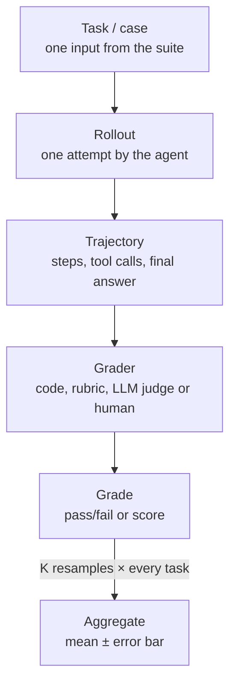

<!--
INSTRUCTIONS FOR CLAUDE — do not render
- This page is Igor's draft built from Cameron Wolfe's AI Engineer NYC talk. Explanation is original; never paste the speaker's sentences.
- Every step links a verified timestamp (youtu.be/zLc8zeGeNaY?t=SEC). Re-check against the captions before changing one.
- The TODO-for-Igor alerts are Igor's to fill. Don't write his opinions into them.
-->

Grading a math answer is a string compare. Grading a short story, a show synopsis, or an agent's research report has no answer key, and that's where most of the AI systems people actually want to build live. An eval exists to answer one question: did this change make the system better? A new prompt, a new model, a new tool for the agent. If the score can't tell a real improvement from a lucky run, it's decoration.

Cameron Wolfe's talk at AI Engineer NYC describes this perfectly, and this page turns it into a recipe for people figuring out how to build AI systems.





<!-- prettier-ignore-start -->
<!-- vim-markdown-toc-start -->

- [Why it's hard](#why-its-hard)
- [The recipe](#the-recipe)
  - [1. Write down what "good" means, with experts](#1-write-down-what-good-means-with-experts)
  - [2. Calibrate the humans](#2-calibrate-the-humans)
  - [3. Decide how much data, and which data](#3-decide-how-much-data-and-which-data)
  - [4. Build an automatic stand-in for the humans](#4-build-an-automatic-stand-in-for-the-humans)
  - [5. Grade the grader](#5-grade-the-grader)
  - [6. Turn it into a benchmark and report the noise](#6-turn-it-into-a-benchmark-and-report-the-noise)
  - [7. Funnel: many offline, few to humans](#7-funnel-many-offline-few-to-humans)
  - [8. A/B test before you ship](#8-ab-test-before-you-ship)
  - [9. Keep watching, feed failures back, repeat](#9-keep-watching-feed-failures-back-repeat)
  - [The whole loop on one line](#the-whole-loop-on-one-line)
- [What's the point of an eval if it doesn't drive a business outcome?](#whats-the-point-of-an-eval-if-it-doesnt-drive-a-business-outcome)
- [Human attention: your most precious resource](#human-attention-your-most-precious-resource)
- [Where I am on this](#where-i-am-on-this)
- [Watch the talk](#watch-the-talk)
- [Appendix: useful taxonomy](#appendix-useful-taxonomy)

<!-- vim-markdown-toc-end -->
<!-- prettier-ignore-end -->

## Why it's hard

Wolfe's goal is simple to say: when a score goes up, he wants it to be because the model got better, not because the run got lucky ([12:49](https://youtu.be/zLc8zeGeNaY?t=769)). Three things fight that:

- The agent is random. Run the same [task](#appendix-useful-taxonomy) twice and you get two different [rollouts](#appendix-useful-taxonomy) ([1:48](https://youtu.be/zLc8zeGeNaY?t=108)).
- Suites stay small, because a single run of some recent benchmarks costs tens of thousands of dollars ([2:08](https://youtu.be/zLc8zeGeNaY?t=128)).
- With no answer key, the [grader](#appendix-useful-taxonomy) can't be a function. It becomes an LLM judge or a rubric, so the one deterministic piece turns into a second source of noise ([3:29](https://youtu.be/zLc8zeGeNaY?t=209)).

Stack those and you can't tell whether the agent got better or worse ([3:45](https://youtu.be/zLc8zeGeNaY?t=225)). His answer has three parts that feed each other ([3:55](https://youtu.be/zLc8zeGeNaY?t=235)): human evaluation defines good, offline evaluation stands in for the humans cheaply, and production monitoring checks what real users do.

## The recipe

### 1. Write down what "good" means, with experts

Before any automation, set up human review, because it's the reference everything else gets checked against ([4:30](https://youtu.be/zLc8zeGeNaY?t=270)). Sit with a few people who know the domain and write quality guidelines:

- a short list of criteria,
- how each one is scored (yes/no or a 1–5 scale),
- lots of detail and worked examples, so a stranger would score the same way.

### 2. Calibrate the humans

Don't assume the guidelines work. Have several people score the same items, measure how often they agree, and rewrite the guidelines wherever they split ([5:26](https://youtu.be/zLc8zeGeNaY?t=326)). Repeat until agreement is high. His further-reading slide points at Fleiss' kappa and Krippendorff's alpha for measuring it; I collected how low human agreement runs in practice in [Humans don't agree either](/ai-testing#humans-dont-agree-either).

### 3. Decide how much data, and which data

**How much**: power analysis ([6:23](https://youtu.be/zLc8zeGeNaY?t=383)). Pick the smallest gap between two versions you care about, estimate how noisy scores are (resampling the same items helps), pick how sure you want to be, and the math gives a sample size. The slide has the formula:

> **n = (zα/2 + zβ)² × (ω² + σA²/KA + σB²/KB) / δ²**

- **δ**: the smallest difference worth detecting
- **ω²**: how much the per-item score difference between A and B varies
- **σ²/K**: leftover run-to-run noise, shrunk by taking K resamples per item

A worked example of my own, not from the talk: at the usual 95% confidence and 80% power the first factor is about 7.8. If per-item score differences have a standard deviation of 0.3 on a 0–1 scale and I want to catch a 0.05 improvement, that's about 280 items. To catch a 0.10 improvement, about 70. Halving the gap you want to see quadruples the data.

**Which data** ([7:12](https://youtu.be/zLc8zeGeNaY?t=432)): items that look like production traffic and cover its variety, hard enough that different models get different scores (find them by sampling a few models and seeing what they fail), and correct, cleaned with a mix of model and human filtering. This applies to every eval set, not only the human one.

### 4. Build an automatic stand-in for the humans

Humans can't review every experiment, so build an [offline](#appendix-useful-taxonomy) proxy ([8:20](https://youtu.be/zLc8zeGeNaY?t=500)). Start at the bottom rung:

- **Deterministic grader**: string match, symbolic math check, unit tests ([2:37](https://youtu.be/zLc8zeGeNaY?t=157)). Same answer every time, so use one wherever the task allows ([my scoring rules](/ai-testing#scoring-rules-i-trust)).
- **LLM judge**: one set of quality guidelines, applied to every task, much like the human reviewers.
- **Rubric** ([8:57](https://youtu.be/zLc8zeGeNaY?t=537)): a checklist written per task, each item checked on its own. More specific, so more objective. His example is from the [DR Tulu paper](https://arxiv.org/abs/2511.19399), where a deep-research answer about adapting a novel for the screen is graded against a list of concrete things it must contain ([9:09](https://youtu.be/zLc8zeGeNaY?t=549)).

There's a trade-off here that runs through the whole recipe: the more I can trust a grade, the less it can assess. Each rung up handles more complex work and input nobody predefined, and costs trust that I then have to earn back by checking it.

| Grader             | How far I can trust the grade         | How complex a thing it can assess  | Input nobody predefined |
| ------------------ | ------------------------------------- | ---------------------------------- | ----------------------- |
| Deterministic code | Fully: same answer every time         | Only what I can write down as code | Breaks                  |
| Rubric / LLM judge | Only after checking it against humans | Tone, faithfulness, coverage       | Mostly copes            |
| Calibrated human   | The reference, once raters agree      | Anything an expert can judge       | Copes                   |

That's why the recipe calibrates humans (step 2) before trusting them and grades the judge (step 5) before trusting it.



### 5. Grade the grader

The judge is a proxy, so check it before trusting it ([9:54](https://youtu.be/zLc8zeGeNaY?t=594)). Take items the calibrated humans scored and you're confident in (he calls them golden data), run the judge on them, and measure agreement: correlation for scores, accuracy for pass/fail.

How good is good enough? Depends on how subjective the task is. Use the humans as the bar: aim for the judge to agree with people about as often as people agree with each other ([10:56](https://youtu.be/zLc8zeGeNaY?t=656)). It's the same bar I use in [AI Testing](/ai-testing#humans-dont-agree-either). The strongest check of all ties the judge to a business outcome, which gets [its own section](#whats-the-point-of-an-eval-if-it-doesnt-drive-a-business-outcome).

### 6. Turn it into a benchmark and report the noise

With a judge you trust, build benchmarks the same way as step 3: sample the data carefully, grade with the judge, and keep refreshing the set ([11:26](https://youtu.be/zLc8zeGeNaY?t=686)).

Now both the agent and the grader are random ([11:48](https://youtu.be/zLc8zeGeNaY?t=708)), so throw statistics at it ([12:04](https://youtu.be/zLc8zeGeNaY?t=724)):

- power analysis to size the benchmark,
- error bars on every number,
- resampling (several runs of the agent, several passes of the judge) to shrink variance.

Report each score with its confidence interval next to it. That's what lets you say version B beat version A rather than got luckier.

### 7. Funnel: many offline, few to humans

Run lots of ideas through the offline evals, since they're cheap. Send only the winners to human review for a closer look ([13:11](https://youtu.be/zLc8zeGeNaY?t=791)), because [human attention is the scarcest thing in the loop](#human-attention-your-most-precious-resource).

### 8. A/B test before you ship

Human review still leaves one step before launch ([13:26](https://youtu.be/zLc8zeGeNaY?t=806)). Pick production signals ([13:33](https://youtu.be/zLc8zeGeNaY?t=813)):

- **explicit**: thumbs up/down, which of two answers users prefer ([13:45](https://youtu.be/zLc8zeGeNaY?t=825)),
- **implicit**: session length, how often people give up ([13:53](https://youtu.be/zLc8zeGeNaY?t=833)).

Compare the new agent against the current one in an A/B test, sized with the same power math ([14:13](https://youtu.be/zLc8zeGeNaY?t=853)). Treat it as a soft launch: prove it on a slice of traffic before rolling out to everyone ([14:36](https://youtu.be/zLc8zeGeNaY?t=876)).

### 9. Keep watching, feed failures back, repeat

After launch, watch for drift, new failure cases and uses nobody planned for, and push them back into the offline and human sets ([15:07](https://youtu.be/zLc8zeGeNaY?t=907)). The slides call this Step Four ([15:16](https://youtu.be/zLc8zeGeNaY?t=916)): tighten the criteria, re-calibrate humans and judges, swap in harder data before the benchmark saturates, or run the whole loop again for a new domain.

### The whole loop on one line

Offline evals screen → humans confirm → A/B test decides → ship → production failures feed the next round. Noise gets fought at every step ([15:46](https://youtu.be/zLc8zeGeNaY?t=946)).

## What's the point of an eval if it doesn't drive a business outcome?

It's easy to lose the forest for the trees. I can spend weeks pushing a judge's agreement with raters up a few more points and forget why I wanted the judge at all. Agreement with humans is a means. The end is the product doing better for the people who use it.

Wolfe's example is a Netflix project he worked on ([writeup](https://netflixtechblog.com/evaluating-netflix-show-synopses-with-llm-as-a-judge-6269251e6f28)), where, he says, the judge's scores were causally linked to viewers abandoning shows ([10:34](https://youtu.be/zLc8zeGeNaY?t=634)). Once a bad score predicts people walking away, the eval is a business metric I can run before launch.



## Human attention: your most precious resource

Every part of this recipe runs on people: experts writing guidelines, raters calibrating, reviewers checking the winners from the funnel. Their attention is the scarcest input, so every human minute should count. Keeping raters motivated has two parts:

- **Make them efficient.** Give them the most powerful tools and never waste their time. The more polished the interface, the more people want to do the work and the more valued they feel.
- **Make them feel respected.** Show them the impact of their work.



## Where I am on this

My own evals are small: [my benchmark evals](/ai-testing#my-benchmark-evals) grade an agent's blog edits with deterministic checkers and an LLM judge layered on top, and [AI Eval Tools](/ai-eval-tools) covers what I run them with.







## Watch the talk

Cameron Wolfe, staff research scientist at Netflix and author of the Deep (Learning) Focus newsletter, at AI Engineer NYC: How Netflix Evaluates AI When There's No Right Answer (18 minutes).



- [Slides](https://docs.google.com/presentation/d/146TscsJ21LU4kATVS3ES2oC_oZxoCBsTH3soepY25P4/edit?usp=sharing)
- [Evaluating Agents on Highly Subjective Tasks](https://cameronrwolfe.substack.com/p/subjective-evals), his written version
- [His post on statistics for LLM evals](https://cameronrwolfe.substack.com/p/stats-llm-evals): power analysis, error bars and resampling in depth
- [Anthropic's statistical approach to model evals](https://www.anthropic.com/research/statistical-approach-to-model-evals)
- [Hamel Husain's evals FAQ](https://hamel.dev/blog/posts/evals-faq/) and [Eugene Yan on labeling guidelines](https://eugeneyan.com/writing/labeling-guidelines/), both from his reading list

## Appendix: useful taxonomy

The words the talk and this page lean on, with how they fit together:

- **Task (case)**: one input in the eval, with whatever the grader needs to judge the answer.
- **Eval suite / benchmark**: the set of tasks, versioned so scores stay comparable.
- **Trial**: one task run end to end, from input to grade ([1:38](https://youtu.be/zLc8zeGeNaY?t=98)).
- **Rollout**: one attempt by the agent at a task. The agent is random, so two rollouts of the same task differ.
- **Trajectory**: everything the agent did in a rollout: messages, tool calls, intermediate steps, final answer.
- **Grader**: whatever turns a trajectory or answer into a grade: code, a rubric, an LLM judge, or a person.
- **Verifiable task**: one a deterministic grader can check (math, code with tests). Its opposite has no answer key.
- **LLM judge**: a model grading against general quality guidelines.
- **Rubric**: a per-task checklist, each item graded on its own.
- **Golden data**: items humans graded that you trust, used to check the judge.
- **Meta-evaluation**: grading the grader against golden data.
- **Resampling**: running the agent or the judge several times per task and averaging to cut noise.
- **Power analysis**: working out how many tasks you need to detect a difference of a given size.
- **Offline eval**: graded before launch, on a fixed suite.
- **Online / production monitoring**: signals from real users after launch: thumbs, session length, abandonment.
- **A/B test**: the new version against the current one on split live traffic.
- **Saturation**: when every model aces a benchmark and it stops telling them apart.
