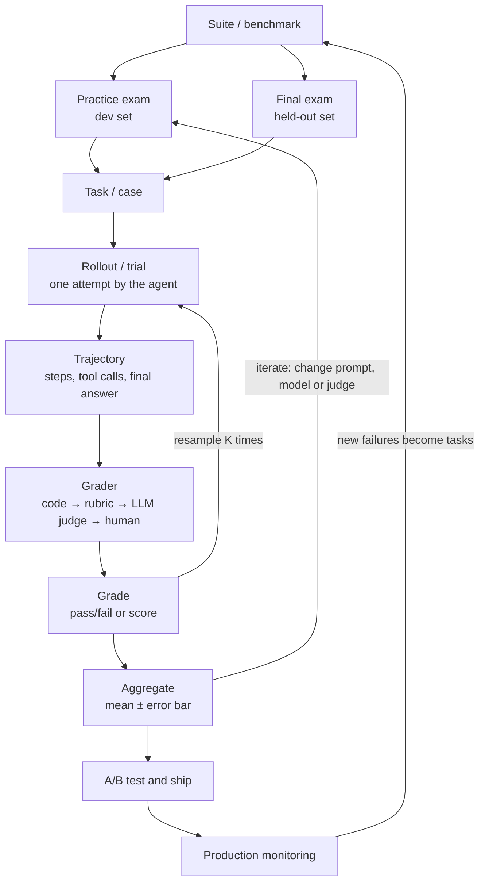

<!--
INSTRUCTIONS FOR CLAUDE — do not render
- This page is Igor's draft, started from the outline of Cameron Wolfe's AI Engineer NYC talk and fleshed out by Igor. Explanation is original; never paste the speaker's sentences.
- State ideas plainly. Credit lives in the intro line and the timestamp links (youtu.be/zLc8zeGeNaY?t=SEC); no "he says / he calls" in the prose.
- Re-check any timestamp against the captions before changing it.
- The TODO-for-Igor alerts are Igor's to fill. Don't write his opinions into them.
-->

Did the change make the system better? That's the one question an eval has to answer, whether the change is a new prompt, a new model or a new tool for the agent. Answering it is hard. It's hardest when there's no right answer to compare against, and most of the AI systems people want to build are like that. A score that can't tell a real improvement from a lucky run is no use.



This page started from the outline of [Cameron Wolfe's AI Engineer NYC talk](#watch-the-talk), and I fleshed it out from there. It's for people figuring out how to build AI systems. I highly recommend the talk.

<!-- prettier-ignore-start -->
<!-- vim-markdown-toc-start -->

- [Why grading is hard](#why-grading-is-hard)
- [The recipe](#the-recipe)
  - [1. Define a policy (aka use experts to decide what good means)](#1-define-a-policy-aka-use-experts-to-decide-what-good-means)
  - [2. Make sure humans can apply the policy consistently](#2-make-sure-humans-can-apply-the-policy-consistently)
  - [3. Decide how many cases and what the cases should be](#3-decide-how-many-cases-and-what-the-cases-should-be)
  - [4. Build an automatic stand-in for the humans](#4-build-an-automatic-stand-in-for-the-humans)
  - [5. Grade the grader](#5-grade-the-grader)
  - [6. Turn it into a benchmark and report the noise](#6-turn-it-into-a-benchmark-and-report-the-noise)
  - [7. The hill-climbing funnel](#7-the-hill-climbing-funnel)
  - [8. A/B test before you ship](#8-ab-test-before-you-ship)
  - [9. Keep watching, feed failures back, repeat](#9-keep-watching-feed-failures-back-repeat)
  - [The whole loop on one line](#the-whole-loop-on-one-line)
- [What's the point of an eval if it doesn't drive a business outcome?](#whats-the-point-of-an-eval-if-it-doesnt-drive-a-business-outcome)
  - [An eval is worth what it predicts](#an-eval-is-worth-what-it-predicts)
  - [Which failures does it catch?](#which-failures-does-it-catch)
- [Human attention: your most precious resource](#human-attention-your-most-precious-resource)
- [Watch the talk](#watch-the-talk)
- [Appendix: useful taxonomy](#appendix-useful-taxonomy)
- [Appendix: the statistics, slowly](#appendix-the-statistics-slowly)
  - [The setup: A, B and the items](#the-setup-a-b-and-the-items)
  - [How many items: power analysis](#how-many-items-power-analysis)
  - [Error bars](#error-bars)
  - [Agreement: kappa and friends](#agreement-kappa-and-friends)

<!-- vim-markdown-toc-end -->
<!-- prettier-ignore-end -->

## Why grading is hard

A grade is only useful if a higher score means a better system ([12:49](https://youtu.be/zLc8zeGeNaY?t=769)). With no right answer, three things get in the way:

- **The same task gives different outputs.** Run one [task](#appendix-useful-taxonomy) twice and you get two different [rollouts](#appendix-useful-taxonomy) ([1:48](https://youtu.be/zLc8zeGeNaY?t=108)). So the grade from one run is partly luck.
- **You can only afford a few cases.** A single run of some recent benchmarks costs tens of thousands of dollars ([2:08](https://youtu.be/zLc8zeGeNaY?t=128)), so suites stay small. With few cases the luck doesn't average out, and the [error bar](#error-bars) on the grade stays wide.
- **The grader is noisy too.** With no answer key, the [grader](#appendix-useful-taxonomy) can't be a function. It's a rubric or an LLM judge, so the one deterministic piece turns into a second source of noise ([3:29](https://youtu.be/zLc8zeGeNaY?t=209)). The grade can move when the output didn't.

Put the three together and you can't tell whether the agent got better or worse ([3:45](https://youtu.be/zLc8zeGeNaY?t=225)). The fix has three parts ([3:55](https://youtu.be/zLc8zeGeNaY?t=235)). Human evaluation defines good. Offline evaluation stands in for the humans cheaply. Production monitoring checks what real users do. Each part feeds the others.

## The recipe

### 1. Define a policy (aka use experts to decide what good means)

Set up human review before any automation. Everything else gets checked against it ([4:30](https://youtu.be/zLc8zeGeNaY?t=270)). Sit with a few people who know the domain and write the policy: the quality guidelines that say what good means. It has:

- a short list of criteria,
- how each one is scored (yes/no or a 1–5 scale),
- lots of detail and worked examples, so a stranger would score the same way.

### 2. Make sure humans can apply the policy consistently

This takes training the humans, a good policy, and unambiguous definitions. Don't assume the policy works. Have several people score the same cases and measure how often they agree ([5:26](https://youtu.be/zLc8zeGeNaY?t=326)). Where they split, rewrite the policy. Repeat until agreement is high. Kappa and its cousins measure it ([the statistics, slowly](#agreement-kappa-and-friends)). [Humans don't agree either](/ai-testing#humans-dont-agree-either) shows how low human agreement runs in practice.

### 3. Decide how many cases and what the cases should be

**How many cases**: power analysis gives the number ([6:23](https://youtu.be/zLc8zeGeNaY?t=383)). It takes three inputs: the smallest improvement worth catching, how noisy the scores are, and how sure you want to be. With typical noise, catching a 5-point gain on a 0–100 scale takes several hundred cases. Halve the gap you want to see and you need four times as many. [The statistics, slowly](#how-many-items-power-analysis) walks through it, and calls a case an item.

**What cases** ([7:12](https://youtu.be/zLc8zeGeNaY?t=432)):

- They look like production traffic and cover its variety.
- They're hard enough that different models get different scores. Find them by sampling a few models and seeing what they fail.
- They're correct. Clean them with a mix of model and human filtering.

The same goes for every eval set on this page, including the ones no human grades.

### 4. Build an automatic stand-in for the humans

Humans can't review every experiment, so build an [offline](#appendix-useful-taxonomy) proxy ([8:20](https://youtu.be/zLc8zeGeNaY?t=500)). The trade-off runs through the whole recipe: the more I can trust a grade, the less it can assess. Each rung up the ladder handles more complex work and more input nobody predefined. I trust each rung less until I've checked it.

| Grader             | How far I can trust the grade         | How complex a thing it can assess     | Input nobody predefined  |
| ------------------ | ------------------------------------- | ------------------------------------- | ------------------------ |
| Deterministic code | Fully: same answer every time         | Only what I can write down as code    | Breaks                   |
| Rubric             | Once each check is shown to work      | Whatever the per-task checklist names | Only what the list names |
| LLM judge          | Only after checking it against humans | Tone, faithfulness, overall quality   | Mostly copes             |
| Calibrated human   | The reference, once raters agree      | Anything an expert can judge          | Copes                    |

The rungs, in the same order:

- **Deterministic code**: string match, symbolic math check, unit tests ([2:37](https://youtu.be/zLc8zeGeNaY?t=157)). Same answer every time, so use it wherever the task allows ([my scoring rules](/ai-testing#scoring-rules-i-trust)).
- **Rubric** ([8:57](https://youtu.be/zLc8zeGeNaY?t=537)): a checklist written per task, each item checked on its own, usually by an LLM. Narrow questions make it more objective than a general judge. In the [DR Tulu paper](https://arxiv.org/abs/2511.19399), a deep-research answer about adapting a novel for the screen is graded against a list of concrete things it must contain ([9:09](https://youtu.be/zLc8zeGeNaY?t=549)).
- **LLM judge**: one set of quality guidelines applied to every task, much like the human reviewers. Human review works in tiers. Lower-paid reviewers follow instructions, and the hard cases go up to higher-paid experts. Medicine does the same: nurses do the frontline triage, a doctor takes what confuses them, and a specialist takes what confuses the doctor. Graders can escalate the same way. Code settles what it can, rubrics and judges take the clear calls, and the uncertain ones go up to a person.
- **Calibrated human**: the expensive top rung. Everything below gets checked against it.

So the recipe calibrates the humans (step 2) before trusting them, and grades the judge (step 5) before trusting it.



### 5. Grade the grader

The judge is a proxy, so check it before trusting it ([9:54](https://youtu.be/zLc8zeGeNaY?t=594)). Run it on items the calibrated humans already scored and measure agreement: correlation for scores, accuracy for pass/fail ([what those mean](#agreement-kappa-and-friends)).

How much agreement is enough depends on how subjective the task is. Use the humans as the bar: the judge should agree with people about as often as people agree with each other ([10:56](https://youtu.be/zLc8zeGeNaY?t=656)). I use the same bar in [AI Testing](/ai-testing#humans-dont-agree-either). The strongest check ties the judge to a business outcome, which gets [its own section](#whats-the-point-of-an-eval-if-it-doesnt-drive-a-business-outcome).

All of this needs a **golden set**: items human experts graded that you trust ([10:01](https://youtu.be/zLc8zeGeNaY?t=601)). Treat it like school exams and split it in two:

- **Practice exam (dev set)**: the part you look at while tuning the judge's prompt, model and rubric. Iterate against it as much as you like.
- **Final exam (held-out set)**: the part you only grade on, once, when you think you're done. If you tune against it, it stops telling you anything.

### 6. Turn it into a benchmark and report the noise

With a judge you trust, build benchmarks the same way as step 3: sample the data carefully, grade with the judge, and keep refreshing the set ([11:26](https://youtu.be/zLc8zeGeNaY?t=686)).

Now both the agent and the grader are random ([11:48](https://youtu.be/zLc8zeGeNaY?t=708)), so use statistics ([12:04](https://youtu.be/zLc8zeGeNaY?t=724)):

- power analysis to size the benchmark,
- [error bars](#error-bars) on every number,
- resampling (several runs of the agent, several passes of the judge) to shrink variance.

Report each score with its confidence interval. Without it you can't say whether version B beat version A or got lucky.

### 7. The hill-climbing funnel

Offline evals are cheap, so run lots of ideas and experiments through them: a rubric versus a general judge, the same judge on different models, several judges voting, a new prompt or a new model for the agent. This is [hill climbing](/hill-climbing): try a change, keep it if the score went up, throw it out if it didn't. If none of your experiments are failing, you're doing something wrong.

Send only the winners to human review for a closer look ([13:11](https://youtu.be/zLc8zeGeNaY?t=791)). [Human attention is the scarcest thing in the loop](#human-attention-your-most-precious-resource).

### 8. A/B test before you ship

After human review there's one more step before launch ([13:26](https://youtu.be/zLc8zeGeNaY?t=806)). Pick production signals ([13:33](https://youtu.be/zLc8zeGeNaY?t=813)):

- **explicit**: thumbs up/down, which of two answers users prefer ([13:45](https://youtu.be/zLc8zeGeNaY?t=825)),
- **implicit**: session length, how often people give up ([13:53](https://youtu.be/zLc8zeGeNaY?t=833)).

Compare the new agent against the current one in an A/B test, sized with the same power math ([14:13](https://youtu.be/zLc8zeGeNaY?t=853)). Treat it as a soft launch: prove it on a slice of traffic before rolling out to everyone ([14:36](https://youtu.be/zLc8zeGeNaY?t=876)).

### 9. Keep watching, feed failures back, repeat

After launch, watch for drift, new failure cases and uses nobody planned for. Push them back into the offline and human sets ([15:07](https://youtu.be/zLc8zeGeNaY?t=907)). Then improve the loop itself ([15:16](https://youtu.be/zLc8zeGeNaY?t=916)): tighten the criteria, re-calibrate humans and judges, swap in harder data before the benchmark saturates, or run the whole loop again for a new domain.

### The whole loop on one line

Offline evals screen → humans confirm → A/B test decides → ship → production failures feed the next round. Every step fights noise ([15:46](https://youtu.be/zLc8zeGeNaY?t=946)).

## What's the point of an eval if it doesn't drive a business outcome?

It's easy to lose the forest for the trees. I can spend weeks pushing a judge's agreement with raters up a few more points and forget why I wanted the judge. I wanted it so the product does better for the people who use it.

### An eval is worth what it predicts

A Netflix project ([writeup](https://netflixtechblog.com/evaluating-netflix-show-synopses-with-llm-as-a-judge-6269251e6f28)) reported that its judge's scores were causally linked to viewers abandoning shows ([10:34](https://youtu.be/zLc8zeGeNaY?t=634)). Once a bad score predicts people walking away, the eval is a business metric I can run before launch.

### Which failures does it catch?

Not every failure is equal. If an eval fails on some obscure failure mode, nobody really cares. The bonus is when the cases it fails are ones humans take notice of.

There's a political side to this. When a business leader sees the failure, they should really care.

The eval itself can be wrong in two ways: it flags a change that was fine, or it lets a bad one through.

|                   | Eval flags it   | Eval lets it through |
| ----------------- | --------------- | -------------------- |
| **Actually bad**  | Caught          | **Miss**             |
| **Actually fine** | **False alarm** | Correct pass         |

The two mistakes don't cost the same. A miss ships a regression to users. A false alarm blocks a good change and wastes reviewer time. Decide which one hurts more for each kind of failure and tune the eval for that, the way [a confusion matrix prices each mistake](/ai-testing#confusion-matrix-precision-and-recall). The idea of pricing every cell comes from Steve Yegge's The Counting House ([my notes](https://idvorkin-ai-tools.github.io/yegge-field-map/ai/the-counting-house.html)).

## Human attention: your most precious resource

This recipe runs on people. Experts write the policy, raters calibrate, and reviewers check the winners from the funnel. Their attention is the scarcest input, so make every human minute count.

**Make them feel respected and valued.** Two parts:

1. **Give them tools that make sure none of their attention is wasted.** That means the most powerful tools, a polished interface and no busywork. The better the interface, the more people want to do the work.
2. **Show them the impact of their work.** Tell them what their labels changed and which launch they unblocked.



## Watch the talk

Cameron Wolfe, staff research scientist at Netflix and author of the Deep (Learning) Focus newsletter, at AI Engineer NYC: How Netflix Evaluates AI When There's No Right Answer (18 minutes).



- [Slides](https://docs.google.com/presentation/d/146TscsJ21LU4kATVS3ES2oC_oZxoCBsTH3soepY25P4/edit?usp=sharing)
- [Evaluating Agents on Highly Subjective Tasks](https://cameronrwolfe.substack.com/p/subjective-evals), his written version
- [His post on statistics for LLM evals](https://cameronrwolfe.substack.com/p/stats-llm-evals): power analysis, error bars and resampling in depth
- [Anthropic's statistical approach to model evals](https://www.anthropic.com/research/statistical-approach-to-model-evals)
- [Hamel Husain's evals FAQ](https://hamel.dev/blog/posts/evals-faq/) and [Eugene Yan on labeling guidelines](https://eugeneyan.com/writing/labeling-guidelines/), both from his reading list

## Appendix: useful taxonomy

How the pieces nest, and where the process loops:

**What gets graded**, from the outside in:

- **Suite / benchmark**: the whole set of tasks. _Why it matters_: version it, or you can't compare last month's score with this month's.
  - **Practice exam (dev set)**: the part you iterate against. _Why it matters_: you need somewhere to tune without fooling yourself.
  - **Final exam (held-out set)**: the part you only grade on. _Why it matters_: it's the only honest score once you've tuned on the rest.
  - **Task (case)**: one input, plus whatever the grader needs to judge the answer. _Why it matters_: a suite is only as good as how realistic and hard its tasks are.
    - **Rollout / trial**: one attempt by the agent at one task, from input to grade ([1:38](https://youtu.be/zLc8zeGeNaY?t=98)). _Why it matters_: the agent is random, so one rollout tells you little.
      - **Trajectory**: everything the agent did in a rollout: messages, tool calls, intermediate steps, final answer. _Why it matters_: grading only the final answer hides how it got there, and which step broke.
        - **Grade**: the pass/fail or score for one trajectory. _Why it matters_: it's noisy twice, once from the agent and once from the grader.
  - **Aggregate**: the grades rolled up into one number with an error bar. _Why it matters_: decisions get made on this number.

**Who grades**, cheapest first (the [ladder in step 4](#4-build-an-automatic-stand-in-for-the-humans)):

- **Deterministic code**: string match, unit tests, symbolic math. _Why it matters_: the only grader that gives the same answer twice.
- **Rubric**: a per-task checklist, each item checked on its own. _Why it matters_: narrow questions get more consistent answers.
- **LLM judge**: a model grading against general quality guidelines. _Why it matters_: it scales to anything, and it's only as good as its agreement with people.
- **Calibrated human**: an expert scoring against written guidelines, checked for agreement. _Why it matters_: the reference every other grader is measured against.
- **Golden set**: items humans graded that you trust, split into the practice and final exams. _Why it matters_: without it you can't check the judge at all.
- **Meta-evaluation**: grading the grader against the golden set. _Why it matters_: you can't trust a judge nobody has checked.

**Where it runs**:

- **Verifiable task**: one deterministic code can check (math, code with tests). _Why it matters_: if you have one, use code and skip most of this page.
- **Offline eval**: graded before launch, on a fixed suite. _Why it matters_: cheap and fast, so it's where most experiments go.
- **Online / production monitoring**: signals from real users after launch: thumbs, session length, abandonment. _Why it matters_: it's what the offline evals are trying to predict.
- **A/B test**: the new version against the current one on split live traffic. _Why it matters_: it's the only test that measures what users do.
- **Saturation**: every model aces the benchmark, so it stops telling them apart. _Why it matters_: swap in harder data before it happens (step 9).

The statistics (resampling, power analysis, error bars, kappa) get their own appendix next.

## Appendix: the statistics, slowly

### The setup: A, B and the items

**A** is what you have now (the current prompt, model or agent) and **B** is the change you're testing. Run both on the same items, and have the grader score each answer from 0 to 1.

- **Per-item score difference**: for one item, B's score minus A's score. Using the same items for both cancels out how hard each item is, so you compare like with like.
- **How much those differences vary (ω²)**: on some items B wins big, on some it loses, on most it's a wash. ω² is the variance of that difference across items.
- **Run-over-run noise (σ²)**: rerun the same item with the same version and the score still moves, because the agent and the judge are random. σ² is that wobble, averaged over items.
- **Resamples (K)**: how many times you run each item. Averaging K runs divides the run-over-run noise by K.
- **Effect size (δ)**: the smallest improvement worth catching, say 0.05 (5 points on a 0–100 scale).
- **Significance level (α)**: how often you're willing to declare a win that's really noise. 5% is the usual pick.
- **Power**: how often you want to catch a real improvement of size δ. 80% is the usual pick.

### How many items: power analysis

The slide's formula ([6:23](https://youtu.be/zLc8zeGeNaY?t=383)):

> **n = (zα/2 + zβ)² × (ω² + σA²/KA + σB²/KB) / δ²**

The first factor turns α and power into a number: at 5% and 80% it's (1.96 + 0.84)² ≈ 7.85. The middle is all the noise. δ² at the bottom is why small effects are expensive.

A worked example of my own, not from the talk. Say per-item differences vary with a standard deviation of 0.3 (ω² = 0.09), and rerunning an item moves its score with a standard deviation of 0.2 (σ² = 0.04 for both A and B):

| Run each item | Smallest gain to catch | Noise term                | Items needed |
| ------------- | ---------------------- | ------------------------- | ------------ |
| once (K = 1)  | 0.05                   | 0.09 + 0.04 + 0.04 = 0.17 | ≈ 534        |
| 4× (K = 4)    | 0.05                   | 0.09 + 0.01 + 0.01 = 0.11 | ≈ 346        |
| once (K = 1)  | 0.10                   | 0.17                      | ≈ 134        |

Two lessons. Halving the gap you want to see quadruples the items (534 vs 134). Resampling saves items: running each one four times cut the count by about a third. That's worth it when items are scarce and runs are cheap.

### Error bars

A pass rate on n items is an estimate, and its 95% error bar is about ±1.96 × √(p(1 − p) / n). At an 80% pass rate on 100 items that's ±8 points, so a 3-point gain between two prompts is noise. Four times the items halves it: ±4 points at 400.

### Agreement: kappa and friends

Used in steps 2 and 5 to check raters against each other and the judge against the raters:

- **Percent agreement**: how often two raters give the same label. It flatters: two raters flipping coins on pass/fail agree half the time.
- **Cohen's kappa**: agreement with luck subtracted, for two raters. κ = (observed − chance) / (1 − chance). If two raters agree 80% of the time and each says "pass" 70% of the time, chance agreement is 0.7 × 0.7 + 0.3 × 0.3 = 0.58, so κ = (0.80 − 0.58) / 0.42 ≈ 0.52. That 80% sounds high, but once luck is taken out it's only moderate.
- **Fleiss' kappa**: the same idea for more than two raters.
- **Krippendorff's alpha**: works with any number of raters, missing labels, and 1–5 scales as well as yes/no. Krippendorff wants 0.8 before relying on the data.
- **Correlation**: for scores rather than labels, whether the judge's scores rise and fall with the humans'.
- **Binary accuracy**: how often the judge's pass/fail matches the humans'. When failures are rare, report pass and fail accuracy separately, or a judge that passes everything looks great.

[Humans don't agree either](/ai-testing#humans-dont-agree-either) has real-world numbers for these.
